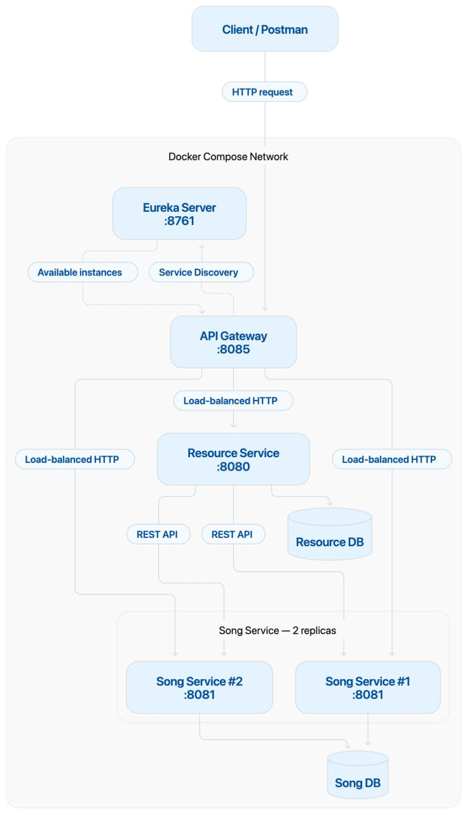

# Audio Resource & Song Services

A microservice-based application for managing audio resources and song metadata.

The project consists of two services:

* **Resource Service** — stores and manages audio files and extracts their metadata.
* **Song Service** — stores and manages song metadata.

The services communicate through REST APIs defined with OpenAPI.

## Architecture

```text
                ┌──────────────┐
                │    Client    │
                └──────┬───────┘
                       │
              ┌────────┴────────┐
              ▼                 ▼
     ┌────────────────┐  ┌────────────────┐
     │ Resource       │  │ Song           │
     │ Service        │◄─┤ Service        │
     │                │  │                │
     │ Audio files    │  │ Song metadata  │
     │ Metadata       │  │ Validation     │
     └────────────────┘  └────────────────┘
```

## Technologies

* Java
* Spring Boot
* Spring Data JPA
* OpenAPI Generator
* REST API
* Apache Tika
* Maven
* Docker / Docker Compose
* Eureka
* API Gateway

## Resource Service

Responsible for:

* uploading audio files;
* storing and retrieving resources;
* deleting resources;
* checking whether a resource exists;
* extracting audio metadata using Apache Tika;
* creating a corresponding Song after a resource is uploaded.

During upload, audio metadata is extracted and the duration is normalized to `mm:ss` format before being sent to the Song Service.

## Song Service

Responsible for:

* creating songs;
* retrieving songs;
* deleting songs;
* validating song metadata;
* checking that the referenced Resource exists when a Song is created directly.

Song validation includes:

* all fields are required;
* `name`, `artist`, and `album`: 1–100 characters;
* `duration`: `mm:ss` with leading zeros;
* `year`: `YYYY`, from 1900 to 2099;
* `id`: must reference an existing Resource.

## Service Communication

The services communicate using REST clients generated from OpenAPI specifications.



When a Resource is uploaded:

```text

Resource Service
  │
  ├── Save Resource
  ├── Extract metadata with Tika
  ├── Normalize duration
  │
  ▼
Song Service
  │
  └── Create Song
```

When a Song is created directly:

```text
Song Service
  │
  ├── Check Resource existence
  │
  └── Create Song
```

## Error Handling

Both services use a global exception handler for consistent error responses.

Typical responses include:

* `400 Bad Request` — validation or invalid request data;
* `404 Not Found` — requested Resource or Song does not exist;
* `409 Conflict` — resource conflict or duplicate data;
* `500 Internal Server Error` — unexpected server error.

# Running the Project

## Local Development

To run the microservices locally, start the applications in the following order:
### 1. Start Eureka Server
   Start `eureka-server` first.
```bash
cd eureka-server
mvn spring-boot:run
```
   Eureka Server will be available at: http://localhost:8761<br>
   Wait until the Eureka Server is fully started before launching the other services.

### 2. Start Resource Service
   Start `resource-service`:
```bash
cd resource-service
mvn spring-boot:run
```
   The service runs on: http://localhost:8080<br>
   Swagger: http://localhost:8080/swagger-ui/index.html

   It registers itself in Eureka as resource-service.

### 3. Start Song Service
   Start `song-service`:
```bash
cd song-service
mvn spring-boot:run
```
   The service runs on: http://localhost:8081<br>
   Swagger: http://localhost:8081/swagger-ui/index.html

   It registers itself in Eureka as song-service.

### 4. Start API Gateway
   Finally, start `api-gateway`:
```bash
cd api-gateway
mvn spring-boot:run
```
   The Gateway runs on: http://localhost:8085<br>
##### Startup Order
```text
   Eureka Server
   ↓
   Resource Service
   ↓
   Song Service
   ↓
   API Gateway
```
   The API Gateway uses Eureka for service discovery and Spring Cloud LoadBalancer for routing requests to available service instances.

## Docker

The entire microservices application can be started using Docker Compose.

### 1. Configure Environment Variables
   Make sure the `.env` file is present in the project root and contains the required database and service configuration.
   
   For Docker, service-to-service URLs should use Docker service names:

   EUREKA_SERVER_URL=http://eureka-server:8761/eureka/<br>
   SONG_SERVICE_URL=http://song-service<br>
   RESOURCE_SERVICE_URL=http://resource-service

### 2. Build and Start All Services
   From the project root directory, run:
```bash
docker compose up -d --build
```
This starts:
```text
Eureka Server
API Gateway
Resource Service
Song Service
Resource PostgreSQL
Song PostgreSQL
```
### 3. Start Song Service with Two Replicas
   To run two instances of song-service, use:
```bash
docker compose up -d --build --scale song-service=2
```
   Both instances use the same internal application port:
```text
song-service #1 → :8081
song-service #2 → :8081
```

### 4. Check Running Containers
   To verify that all containers are running:
```bash
docker compose ps
```
   For two song-service replicas, the output should contain two containers:
```text
song-service-1
song-service-2
```

### 7. Stop the Application
   To stop all containers:
```bash
docker compose down
```

## Verifying Service Registration
After starting all services, open:<br>
http://localhost:8761

The Eureka dashboard should show:
* EUREKA-SERVER — UP
* RESOURCE-SERVICE — UP
* SONG-SERVICE — UP
* API-GATEWAY — UP

## Accessing Services Through the Gateway
   For normal client requests, use the API Gateway instead of accessing individual services directly:

   GET  http://localhost:8085/resources/{id}<br>
   GET  http://localhost:8085/resources/{id}/exists<br>
   POST http://localhost:8085/resources<br>
   DELETE http://localhost:8085/resources<br>

   GET  http://localhost:8085/songs/{id}<br>
   DELETE http://localhost:8085/songs<br>
   POST http://localhost:8085/songs<br>

   The Gateway routes requests according to the configured paths:
```text
   /resources/** → resource-service<br>
   /songs/**     → song-service
```

## OpenAPI

API contracts are defined using OpenAPI.

OpenAPI Generator is used to generate:

* Spring controllers;
* REST API interfaces;
* Java REST clients.

After changing an OpenAPI specification, regenerate the sources:

```bash
mvn clean generate-sources
```
